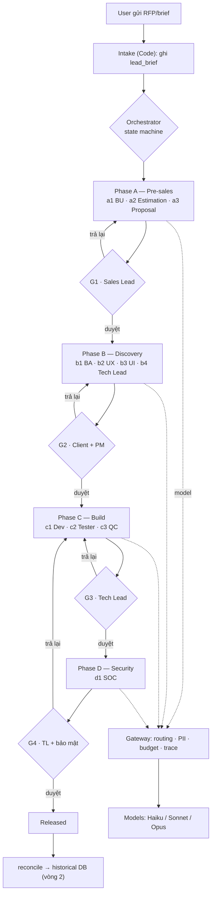
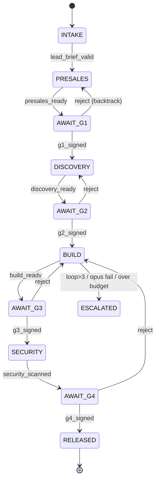
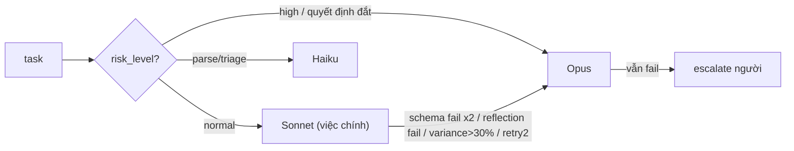
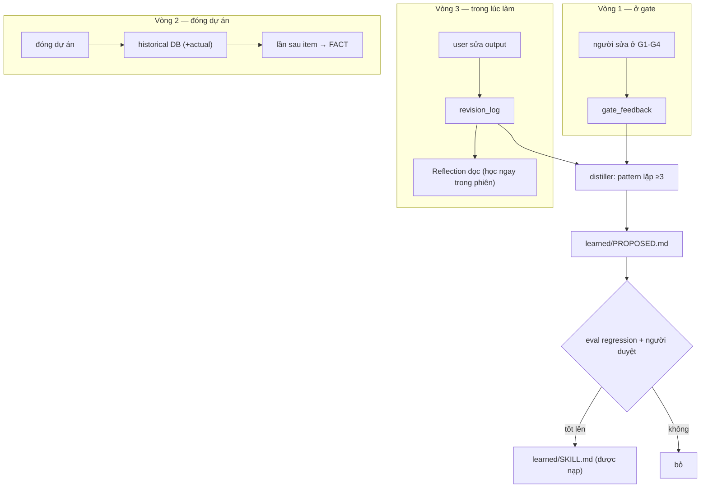

# SPEC — Outsourcing Multi-Agent Framework

Đặc tả workflow và logic hệ thống, để tra cứu sau. Diagram dùng mermaid (tự vẽ trên GitHub / trình xem Markdown hỗ trợ mermaid).

---

## 1. Tổng quan

Hệ gồm 11 agent chạy qua 4 phase, điều phối bằng một state machine (Code). Agent không chat trực tiếp — phối hợp qua Blackboard (ghi/đọc vùng). Mọi lần gọi model đi qua Gateway. 4 cổng người duyệt chặn mọi thứ ra ngoài. Hệ học qua 3 vòng, bồi vào 4 lớp skill.

Nguyên tắc nền: **Code > Tool > LLM call > Agent**. Mọi output gắn nhãn **FACT / ASSUMPTION / RECOMMENDATION**. Số liệu do Code tính, không do LLM.

---

## 2. Workflow tổng — một task từ lead tới release



---

## 3. State machine (logic điều phối)

Orchestrator là Code thuần. Mỗi chuyển state có một guard kiểm tra được bằng máy. Không bước nào do LLM quyết định.



| Guard | Điều kiện (Code kiểm) |
|---|---|
| presales_ready | estimate + proposal qua schema, Reflection pass, assumption coverage 100% |
| discovery_ready | ≥95% story qua ac_lint, backlog không vòng |
| build_ready | build/test/lint/scope pass + QC không còn Critical |
| security_scanned | security_report đã ghi |
| g*_signed | có chữ ký gate tương ứng (chỉ người ký) |

Backtrack: gate từ chối → quay về phase trước, huỷ mọi chữ ký gate phía sau.

---

## 4. Giải phẫu một agent (logic bên trong)

```mermaid
sequenceDiagram
    participant O as Orchestrator
    participant R as runtime (4 module)
    participant K as skill_loader
    participant G as Gateway
    participant M as Model
    participant B as Blackboard
    O->>R: chạy agent
    R->>R: M2 validate INPUT (schema)
    R->>K: nạp skill: personal→learned→team→_core
    R->>R: Reflection đọc revision_log (học trong phiên)
    R->>G: gọi model (tier theo routing)
    G->>G: PII mask · budget · chọn Haiku/Sonnet/Opus
    G->>M: request
    M-->>G: text
    G->>G: ghi trace (model/token/cost)
    G-->>R: text
    R->>R: M4 validate OUTPUT; lỗi → retry → escalate
    R->>R: post-process (số liệu, coverage) — Code, không LLM
    R->>B: ghi vùng của agent (kiểm quyền)
```

4 module: M1 Identity (vai trò + Forbidden) · M2 Input Contract · M3 Task (+ skill guidance) · M4 Output Contract. Skill 4 lớp chỉ chèn vào M3, không nới M1/M2/M4.

---

## 5. Blackboard — data contract

| Vùng | Ghi bởi | Đọc bởi |
|---|---|---|
| lead_brief | intake | tất cả |
| business_context | a1_bu | a2, a3, b1 |
| estimate | a2_estimation | a3, Sales Lead |
| proposal | a3_proposal | Sales Lead (G1) |
| requirements | b1_ba | b2, b3, b4, c1 |
| design_spec | b2_ux | b3, b4 |
| ui_system | b3_ui | b4, c1 |
| architecture, task_backlog | b4_tech_lead | c1, c3 |
| build_results | c1/c2/c3 | d1, PM |
| security_report | d1_soc | Release gate |
| gate_signatures | chỉ người (gate_ui) | Orchestrator |
| risk_register | mọi agent (append) | PM |
| revision_log | mọi agent (append) | Reflection, distiller |
| trace_log | gateway | PM, Eval |

Schema cứng cho estimate/requirements/ui_system/security_report. Vùng append-only: risk_register, revision_log, trace_log.

---

## 6. Model routing (logic chọn model)

Bảng tra bằng Code theo `(agent, task_type, risk_level)`. Bắt đầu tier mặc định, escalate khi có trigger.



Reviewer (QC/Reflection) không yếu hơn generator. Pin version trong `config/models.lock`; đổi version phải chạy lại eval.

---

## 7. Ba vòng học (logic cải thiện)



Phân biệt `kind`: 'edit' (agent sai → học) vs 'preference' (user đổi ý → nhiễu). Skill học được không tự vào prompt — phải qua eval + duyệt.

---

## 8. Human gates

| Gate | Ai duyệt | Chặn gì | Màn hình hiện trước |
|---|---|---|---|
| G1 | Sales Lead | Gửi giá/proposal ra client | ASSUMPTION, WBS lệch >30%, exclusions |
| G2 | Client + PM | Bắt đầu build | scope_delta, open_questions |
| G3 | Tech Lead | Merge | Important còn mở, file ngoài scope |
| G4 | TL + bảo mật | Release | finding High/Critical, QC Critical |

Chữ ký chỉ ghi qua gate_ui. Từ chối → backtrack.

---

## 9. ISO 42001/42005 (governance, tự động)

`src/iso/`: inventory (đăng ký hệ AI) · impact (triage + nháp đánh giá tác động) · conformance (soát bằng chứng → gaps). Deterministic. Là "conformance-ready", không phải chứng chỉ.

---

## 10. Áp cho sản phẩm khác

Giữ `src/` (hạ tầng). Đổi `specs/02_agents/`, `specs/04_schemas/`, `specs/01_state_machine.yaml`, `specs/06_gates.md`, nạp `data/`. Theo 12 bước IDEA → TASK (xem `docs/framework.md`).

---

## 11. PM — quản lý tiến độ (người + máy)

Không có agent PM quyết định. Chia hai phần:
- **Máy (Orchestrator, Code):** tự ghi vùng `project_status` từ Blackboard — phase, % task, gate đã ký, budget, open_risk, open_question quá hạn, build loop. Deterministic, không phán đoán. (`src/orchestrator/status.py`)
- **PM agent (e1_pm, CHỈ ĐỌC):** tổng hợp `project_status` + `risk_register` thành báo cáo + cảnh báo (budget>80%, risk mở, question quá hạn, loop cao) cho **PM người**. KHÔNG ghi, KHÔNG quyết, KHÔNG ký gate. (`src/agents/e1_pm.py`)
- **PM người:** nhận báo cáo, quyết ưu tiên/scope, thương lượng client, ký G2, xử lý escalate, chịu trách nhiệm (RACI).

Dashboard gọi `/api/pm` để hiện bức tranh tiến độ cho PM người.
