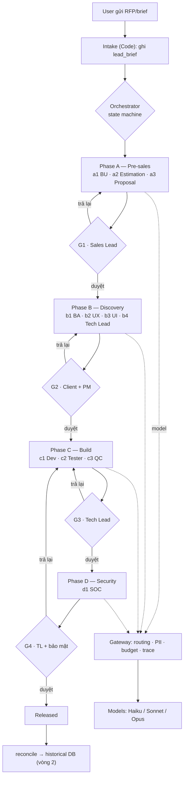
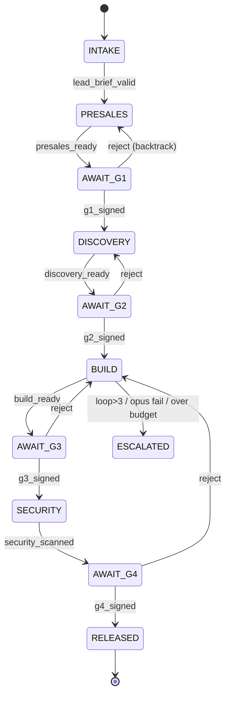
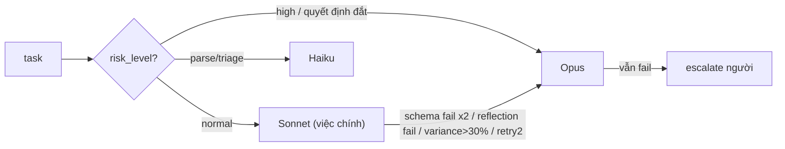
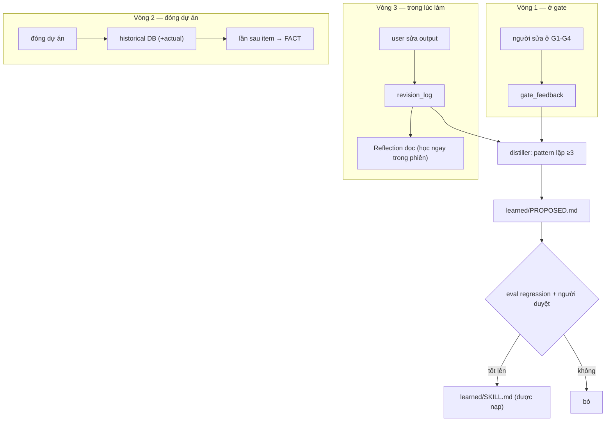
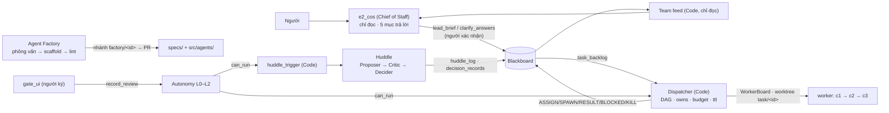

# SPEC — Outsourcing Multi-Agent Framework

Đặc tả workflow và logic hệ thống, để tra cứu sau. Diagram dùng mermaid (tự vẽ trên GitHub / trình xem Markdown hỗ trợ mermaid).

---

## 1. Tổng quan

Hệ gồm 14 agent có spec: 11 agent chạy qua 4 phase (a1…d1) + `e1_pm` (PM, chỉ đọc) + `e2_cos` (Chief of Staff, chỉ đọc + 2 loại yêu cầu có người xác nhận) + `factory_interviewer` (nháp phỏng vấn cho Agent Factory). Điều phối bằng một state machine (Code). Agent không chat trực tiếp — phối hợp qua Blackboard (ghi/đọc vùng). Mọi lần gọi model đi qua Gateway. 4 cổng người duyệt chặn mọi thứ ra ngoài. Hệ học qua 3 vòng, bồi vào 4 lớp skill.

Lớp **bot team v3** (đề án 0002, ADR `docs/adr/0002-bot-team-v3.md`) đặt trên lõi mà không đổi state machine/guard/Blackboard/gateway: Agent Factory, Build Dispatcher, Huddle, Autonomy Ladder L0–L2, Chief of Staff + Team feed — xem §12.

Nguyên tắc nền: **Code > Tool > LLM call > Agent**. Mọi output gắn nhãn **FACT / ASSUMPTION / RECOMMENDATION**. Số liệu do Code tính, không do LLM.

---

## 2. Workflow tổng — một task từ lead tới release



---

## 3. State machine (logic điều phối)

Orchestrator là Code thuần. Mỗi chuyển state có một guard kiểm tra được bằng máy. Không bước nào do LLM quyết định.



| Guard | Điều kiện (Code kiểm) |
|---|---|
| presales_ready | estimate + proposal qua schema, Reflection pass, assumption coverage 100% |
| discovery_ready | ≥95% story qua ac_lint, backlog không vòng |
| build_ready | build/test/lint/scope pass + QC không còn Critical |
| security_scanned | security_report đã ghi |
| g*_signed | có chữ ký gate tương ứng (chỉ người ký) |

Backtrack: gate từ chối → quay về phase trước, huỷ mọi chữ ký gate phía sau.

---

## 4. Giải phẫu một agent (logic bên trong)

```mermaid
sequenceDiagram
    participant O as Orchestrator
    participant R as runtime (4 module)
    participant K as skill_loader
    participant G as Gateway
    participant M as Model
    participant B as Blackboard
    O->>R: chạy agent
    R->>R: M2 validate INPUT (schema)
    R->>K: nạp skill: personal→learned→team→_core
    R->>R: Reflection đọc revision_log (học trong phiên)
    R->>G: gọi model (tier theo routing)
    G->>G: PII mask · budget · chọn Haiku/Sonnet/Opus
    G->>M: request
    M-->>G: text
    G->>G: ghi trace (model/token/cost)
    G-->>R: text
    R->>R: M4 validate OUTPUT; lỗi → retry → escalate
    R->>R: post-process (số liệu, coverage) — Code, không LLM
    R->>B: ghi vùng của agent (kiểm quyền)
```

4 module: M1 Identity (vai trò + Forbidden) · M2 Input Contract · M3 Task (+ skill guidance) · M4 Output Contract. Skill 4 lớp chỉ chèn vào M3, không nới M1/M2/M4.

---

## 5. Blackboard — data contract

| Vùng | Ghi bởi | Đọc bởi |
|---|---|---|
| lead_brief | intake (e2_cos tạo thay người khi có xác nhận) | tất cả |
| business_context | a1_bu | a2, a3, b1 |
| estimate | a2_estimation | a3, Sales Lead |
| proposal | a3_proposal | Sales Lead (G1) |
| requirements | b1_ba | b2, b3, b4, c1 |
| design_spec | b2_ux | b3, b4 |
| ui_system | b3_ui | b4, c1 |
| architecture | b4_tech_lead | c1, c3 |
| task_backlog | b4_tech_lead (tạo, có `owns`/`deps`) · orchestrator (Dispatcher cập nhật substate) | Dispatcher, c1, c3 |
| build_results | c1/c2/c3 | d1, PM |
| security_report | d1_soc | Release gate |
| gate_signatures | chỉ người (gate_ui) | Orchestrator |
| risk_register | mọi agent (append) | PM |
| revision_log | mọi agent (append) | Reflection, distiller |
| trace_log | gateway · orchestrator (Dispatcher: ASSIGN/SPAWN/RESULT/BLOCKED/KILL) | PM, Eval, Team feed |
| project_status | orchestrator | e1_pm, e2_cos, dashboard |
| clarify_answers | clarify (e2_cos qua `clarify.resolve` khi có xác nhận) | clarify (pending/done → cho estimate) |
| huddle_log | agent tham gia huddle + huddle (append) | Team feed (không lên gate) |
| decision_records | huddle (append) | G1/G2 (gate_view), clarify, e2_cos |

Nguồn sự thật: `specs/05_blackboard.yaml` (runtime đọc thẳng). Schema cứng cho lead_brief/estimate/requirements/ui_system/security_report/project_status (`src/blackboard/schema/`). Vùng append-only: risk_register, revision_log, trace_log, huddle_log, decision_records.

---

## 6. Model routing (logic chọn model)

Bảng tra bằng Code theo `(agent, task_type, risk_level)`. Bắt đầu tier mặc định, escalate khi có trigger.



Reviewer (QC/Reflection) không yếu hơn generator. Pin version trong `config/models.lock`; đổi version phải chạy lại eval.

---

## 7. Ba vòng học (logic cải thiện)



Phân biệt `kind`: 'edit' (agent sai → học) vs 'preference' (user đổi ý → nhiễu). Skill học được không tự vào prompt — phải qua eval + duyệt.

---

## 8. Human gates

| Gate | Ai duyệt | Chặn gì | Màn hình hiện trước |
|---|---|---|---|
| G1 | Sales Lead | Gửi giá/proposal ra client | ASSUMPTION, WBS lệch >30%, exclusions |
| G2 | Client + PM | Bắt đầu build | scope_delta, open_questions |
| G3 | Tech Lead | Merge | Important còn mở, file ngoài scope |
| G4 | TL + bảo mật | Release | finding High/Critical, QC Critical |

Chữ ký chỉ ghi qua gate_ui. Từ chối → backtrack. Danh tính máy (writer zone, agent có spec, hệ thống, `auto*`) không bao giờ ký được — danh sách dùng chung ở `src/governance/confirm.py`. Không có auto-gate (L3 bảo lưu).

---

## 9. ISO 42001/42005 (governance, tự động)

`src/iso/`: inventory (đăng ký hệ AI) · impact (triage + nháp đánh giá tác động) · conformance (soát bằng chứng → gaps). Deterministic. Là "conformance-ready", không phải chứng chỉ.

---

## 10. Áp cho sản phẩm khác

Giữ `src/` (hạ tầng). Đổi `specs/02_agents/`, `specs/04_schemas/`, `specs/01_state_machine.yaml`, `specs/06_gates.md`, nạp `data/`. Theo 12 bước IDEA → TASK (xem `docs/framework.md`).

---

## 11. PM — quản lý tiến độ (người + máy)

Không có agent PM quyết định. Chia hai phần:
- **Máy (Orchestrator, Code):** tự ghi vùng `project_status` từ Blackboard — phase, % task, gate đã ký, budget, open_risk, open_question quá hạn, build loop. Deterministic, không phán đoán. (`src/orchestrator/status.py`)
- **PM agent (e1_pm, CHỈ ĐỌC):** tổng hợp `project_status` + `risk_register` thành báo cáo + cảnh báo (budget>80%, risk mở, question quá hạn, loop cao) cho **PM người**. KHÔNG ghi, KHÔNG quyết, KHÔNG ký gate. (`src/agents/e1_pm.py`)
- **PM người:** nhận báo cáo, quyết ưu tiên/scope, thương lượng client, ký G2, xử lý escalate, chịu trách nhiệm (RACI).

Dashboard gọi `/api/pm` để hiện bức tranh tiến độ cho PM người.

---

## 12. Bot team v3 (đề án 0002) — lớp tổ chức trên lõi

Nguyên tắc: **chat thì sống, output thì cứng**. Không mục nào đổi state machine, guard `gates.py`, quyền Blackboard hay gateway.



| Hạng mục | Module | Luật chính | Tài liệu |
|---|---|---|---|
| H1 Agent Factory | `src/factory/` (interview · scaffold · templates · yaml_edit · agent_lint · new) | LLM chỉ nháp (RECOMMENDATION); người xác nhận; Code sinh file trên nhánh `factory/<id>`, không ghi đè, rollback; agent mới L0 | `docs/factory.md` |
| H2 Build Dispatcher | `src/orchestrator/dispatcher/` | DAG `deps`, `owns` không giao, `max_parallel`/ttl/budget từ config, depth 1 theo dự án, không bao giờ `merged`, worktree theo nhánh task cha | `docs/dispatcher.md` |
| H3 Huddle | `src/agents/huddle.py` + `src/orchestrator/huddle_trigger.py` | Trigger bằng Code; ≤ `max_rounds`; bắt buộc `decision_record`; chỉ append 2 zone; **không nối state machine** (gọi tay) | `docs/huddle.md` |
| H4 Autonomy | `src/orchestrator/autonomy.py` | Theo cặp (agent, task_type); nâng = đề xuất + người duyệt; hạ tự động; `HARD_MAX = L2` | `docs/autonomy.md` |
| H5 CoS + Team feed | `src/agents/e2_cos.py`, `src/orchestrator/team_feed.py`, `src/tools/integrations/figma.py` | CoS chỉ đọc (ReadOnlyBoard), 2 loại yêu cầu có xác nhận; feed chỉ summary; Figma chỉ GET | `docs/cos.md`, `docs/team-feed.md` |

---

## 13. Cấu trúc `src/` (sau refactor 2026-11-03)

| Thư mục | Trách nhiệm |
|---|---|
| `common/` | `config.py` — đọc config/specs YAML/JSON một chỗ, thiếu file/khoá → `ConfigError`; `jsonl.py` — log JSONL append-only |
| `governance/` | `confirm.py` — danh sách "không phải người" + `require_human` + `payload_hash`, dùng chung cho `Blackboard.sign`, Factory, CoS, Autonomy |
| `blackboard/` | `store.py` (quyền + schema theo zone) · `proxy.py` (`ReadOnlyBoard`, `WorkerBoard` — không lộ board thật) |
| `gateway/` | `llm_client` (cửa duy nhất ra model) · `router` · `budget` (sổ chung, reserve/commit/allocation) · `pii_mask` · `trace` |
| `orchestrator/` | `state_machine` · `gates` · `escalation` · `status` · `skill_loader` · `gate_view` · `events` (EventType + emit) · `team_feed` · `huddle_trigger` · `autonomy` · `dispatcher/` |
| `orchestrator/dispatcher/` | `settings` (hằng số + config) · `dag` · `registry` (depth guard + zombie) · `worker` · `gitops` · `scheduler` (vòng run) · `core` (class `Dispatcher`) |
| `agents/` | `runtime` (4 module) + 14 runner + `huddle` + `clarify` — chỗ DUY NHẤT có logic LLM |
| `factory/` | Agent Factory (H1) |
| `tools/` | `checks/` · `estimation/` · `security/` (stub) · `integrations/` (`repo` git cục bộ thật, `figma` chỉ đọc, `jira`/`confluence` stub) |
| `server/` | `app.py` (route FastAPI) · `demo.py` (kịch bản demo) |
| `store/` `learning/` `feedback/` `reconcile/` `iso/` `demo/` | historical DB · vòng 3 · vòng 1 · vòng 2 · ISO 42001 · dry_run/live_one |

Import path công khai cũ giữ nguyên (`src.orchestrator.dispatcher`, `src.factory.scaffold`, `src.agents.e2_cos.CosBoard`…).
