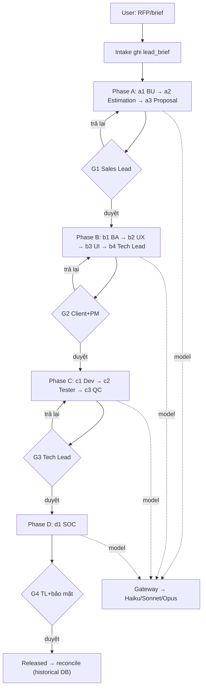

# Hướng dẫn tool — Outsourcing Multi-Agent Framework

Cây thư mục, chức năng từng block, cách dùng, và workflow khi nhận task. (Bản cập nhật theo cấu trúc hiện tại: 14 agent, 4 lớp skill, 3 vòng học, bot team v3.)

---

## 1. Tool này là gì

Khung **multi-agent** chạy vòng đời delivery outsourcing (lead → proposal → discovery → build → release), xây theo **IDEA → TASK Framework v5**. Không phải sản phẩm "cài là chạy", mà là **giàn giáo có kỷ luật**: hạ tầng đã chạy + có test; phần nghiệp vụ để trống cho bạn điền.

### Ba ranh giới phải nắm
| Ranh giới | Nội dung |
|---|---|
| **Code vs trống** | Hạ tầng (orchestrator, blackboard, gateway, routing, 3 vòng học, ISO, test) đã chạy. Nghiệp vụ (gọi model thật, vài bước TASK, tool ngoài repo/Jira/scanner) để trống. |
| **Ai sửa gì** | `specs/` = luật (admin). `knowledge/` = kinh nghiệm + hệ học (người dùng + distiller). `src/` = code (Claude Code). |
| **Người vs máy** | Máy chạy phần lặp; người giữ 4 cổng (giá/scope/merge/release) + duyệt skill học được. Không tự gửi client, chốt giá, release. |

---

## 2. Cây thư mục

```
outsourceAgent/
├── CLAUDE.md                 # Hiến pháp cho Claude Code
├── README.md  requirements.txt
│
├── specs/                    # LUẬT (admin viết) — nguồn sự thật
│   ├── 00_overview.md
│   ├── 01_state_machine.yaml     # states + transitions + guard
│   ├── 02_agents/                # MỖI ROLE 1 FILE: Agent Card v5 + prompt 4 module
│   │   ├── a1_bu.md  a2_estimation.md  a3_proposal.md        (Phase A)
│   │   ├── b1_ba.md  b2_ux.md  b3_ui.md  b4_tech_lead.md     (Phase B)
│   │   ├── c1_dev.md c2_tester.md c3_qc.md                   (Phase C)
│   │   ├── d1_soc.md                                         (Phase D)
│   │   └── e1_pm.md  e2_cos.md  factory_interviewer.md       (cross-cutting / Factory)
│   ├── 03_routing.yaml           # model tier + escalate
│   ├── 04_schemas/               # <zone>.json và <agent>.in/out.json
│   ├── 05_blackboard.yaml        # quyền ghi theo vùng + retention
│   └── 06_gates.md               # G1–G4
│
├── knowledge/                # KINH NGHIỆM + HỆ HỌC. 4 lớp, không nới luật.
│   └── <role>/                   # ba bu estimation proposal ux ui tech_lead dev tester qc soc
│       ├── team/SKILL.md             # đã duyệt (gồm skill internet đã vet)
│       ├── personal/<user>/SKILL.md  # cá nhân tự nhập
│       └── learned/                  # hệ tự rút từ revision_log (proposed → promote)
│
├── config/                   # budgets.yaml · autonomy.yaml · models.lock · providers.yaml
│
├── data/                     # Dữ liệu tool đọc (số liệu KHÔNG để trong prompt)
│   ├── historical_projects/      # dự án đã đóng → nguồn FACT
│   ├── rate_cards/  sizing_model.yaml   # rate + parametric S/M/L/XL
│   ├── templates/                # proposal/SOW + DESIGN.md
│   └── coding_standards/
│
├── src/                      # CODE (Claude Code sinh)
│   ├── common/                   # config loader (ConfigError) + jsonl
│   ├── governance/               # confirm.py: xác nhận của người, danh sách "không phải người"
│   ├── orchestrator/             # state machine + gates + escalation + skill_loader (4 lớp) + events
│   │   │                         #   + team_feed + huddle_trigger + autonomy + gate_view + status
│   │   └── dispatcher/           # H2: settings · dag · registry · worker · gitops · scheduler · core
│   ├── gateway/                  # router + llm_client + pii_mask + budget + trace
│   ├── blackboard/               # store (phân quyền đọc từ specs/05_blackboard.yaml) + proxy + schema
│   ├── agents/                   # runtime 4-module + 14 runner + huddle + clarify
│   ├── factory/                  # H1: interview · scaffold · templates · yaml_edit · agent_lint · new
│   ├── tools/                    # checks + estimation (parametric) + security (stub) + integrations (repo, figma)
│   ├── store/                    # historical DB (lookup/append/variance, holdout)
│   ├── learning/                 # VÒNG 3: revision_log + reflection trong phiên + distiller
│   ├── feedback/                 # VÒNG 1: gate feedback
│   ├── reconcile/                # VÒNG 2: đóng dự án → historical DB
│   ├── iso/                      # inventory + impact + conformance (42001/42005)
│   ├── gate_ui/                  # cổng duyệt (chữ ký G1–G4)
│   ├── server/                   # dashboard FastAPI (app.py) + kịch bản demo (demo.py)
│   └── demo/                     # dry_run (mock) + live_one (thật)
│
├── eval/                     # holdout + metrics + testsets + baselines + runs
├── tests/                    # unit + contract (pytest -q)
└── docs/                     # SPEC · HANDOFF · TOOL_GUIDE · factory · dispatcher · huddle · autonomy · cos
                              # · team-feed · dashboard · runbook · training-loops · framework · adr/
```

---

## 3. 14 agent (11 theo dòng chảy 1 task + 3 cross-cutting)

| # | Agent | Phase | Vào (đọc) | Ra (ghi Blackboard) |
|---|---|---|---|---|
| a1 | BU | A | lead_brief | business_context |
| a2 | Estimation | A | business_context | estimate (FACT/ASSUMPTION) |
| a3 | Proposal | A | business_context, estimate | proposal |
| b1 | BA | B | proposal, business_context | requirements (story+AC) |
| b2 | UX | B | requirements | design_spec (flows/screens/states) |
| b3 | UI | B | design_spec | ui_system (tokens.css + component) |
| b4 | Tech Lead | B | requirements, design_spec | architecture + task_backlog |
| c1 | Dev | C | task_backlog | build_results |
| c2 | Tester | C | build_results | build_results |
| c3 | QC | C | build_results | build_results (verdict) |
| d1 | SOC | D | build_results | security_report |
| e1 | PM | — | project_status, risk_register | (chỉ đọc, báo cáo) |
| e2 | Chief of Staff | — | project_status, risk, decision_records, Team feed | (chỉ đọc; lead_brief/clarify_answers khi người xác nhận) |
| — | factory_interviewer | Factory | ý tưởng agent mới | (nháp answers, không ghi Blackboard) |

Gates: **G1** sau a3 (Sales Lead), **G2** sau b4 (Client+PM), **G3** sau c3 (Tech Lead), **G4** sau d1 (TL+bảo mật).

---

## 4. Bốn lớp skill (thứ tự nạp)

`personal → learned → team → _core` (core cuối, hiệu lực cao nhất).

| Lớp | Nguồn | Trạng thái |
|---|---|---|
| `_core` (specs) | Luật, admin | khoá |
| `team/` | Đã duyệt (gồm skill internet đã vet) | dùng |
| `personal/<user>/` | Cá nhân tự nhập | dùng |
| `learned/` | Hệ tự rút từ `revision_log` | proposed → eval → promote |

Skill chỉ chèn vào MODULE 3; không nới Forbidden/Output. Con số → `data/`.

---

## 5. Cách dùng

```bash
cd outsourceAgent
python -m venv .venv && source .venv/bin/activate   # Python ≥ 3.10
pip install -r requirements.txt
pytest -q                           # toàn bộ test, không cần key
python -m src.factory.agent_lint --all   # chuẩn agent (14/14)

python -m src.demo.dry_run          # xem cả 4 phase (mock, không tốn token)
export ANTHROPIC_API_KEY=sk-...
python -m src.demo.live_one         # chạy thật 1 agent
uvicorn src.server.app:app --reload # dashboard http://localhost:8000
```

- Sửa cách agent làm → `specs/02_agents/<id>.md` (MODULE 3 / Forbidden). Siết output → `specs/04_schemas/<id>.out.json`.
- Thêm kinh nghiệm → `knowledge/<role>/personal/<tên>/`. Con số → `data/`.
- Skill internet → `knowledge/<role>/team/` + eval, không vào `_core`.
- Hệ học → tự ghi `revision_log`; `distiller` cô đọng; duyệt rồi promote lên `team`.
- Đóng dự án → `reconcile.close(...)` ghi historical DB → lần sau ra FACT.

---

## 6. Workflow (xem `docs/SPEC.md` để có diagram đầy đủ)



Chi tiết state machine, data contract, 3 vòng học, giải phẫu agent: `docs/SPEC.md`.


## PM (tiến độ)
- `project_status` (Orchestrator ghi, Code): phase · %task · gate · budget · risk · quá hạn · loop.
- `e1_pm` (PM agent, CHỈ ĐỌC): tổng hợp + cảnh báo cho PM người. Không quyết, không ghi, không gate.
- PM người: quyết ưu tiên/scope, ký G2, chịu trách nhiệm. Xem `/api/pm` trên dashboard.
